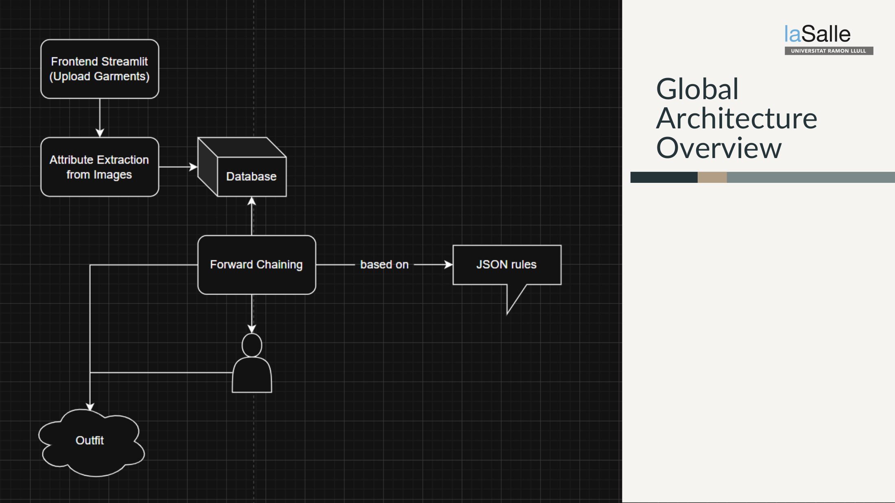
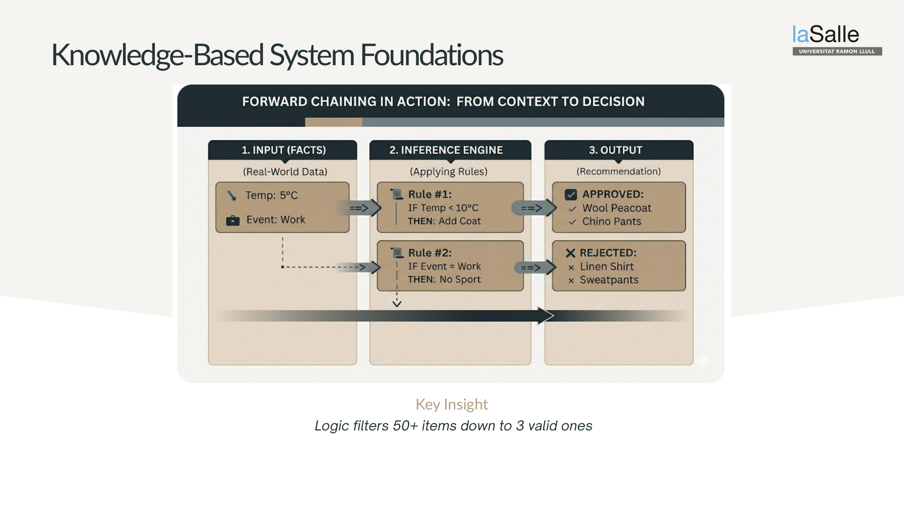

# WearWise

> A knowledge-based system for sustainable wardrobe management: it digitizes the clothes you already own and recommends context-aware, explainable outfits — instead of pushing you to buy more.

Knowledge-Based Systems course project · La Salle — Universitat Ramon Llull · 2025/26



## How it works

1. **Perception (GPT-4o Vision)** — upload a photo of a garment; a zero-shot vision prompt extracts structured attributes (type, colour, material, formality, season…).
2. **Normalization** — a pipeline maps the raw output onto a fixed ontology defined in `normalization.json`, so every garment uses the same vocabulary.
3. **Persistence (MongoDB Atlas)** — garments are stored as documents in your virtual wardrobe.
4. **Reasoning (forward chaining)** — a deterministic Python inference engine fires rules from the user's context:
   - **Weather** — forbids unsafe items (e.g. no linen shirt at 5 °C)
   - **Occasion** — enforces dress codes
   - **Formality** and **season** — narrow down valid candidates
5. **Scoring** — valid candidates are ranked with weighted rewards and penalties for occasion fit, formality, colour harmony and user preference. Every recommendation can be explained by the rules that produced it.



## Tech stack

| Layer | Technology |
|---|---|
| Frontend | Streamlit |
| Perception | OpenAI GPT-4o (vision) |
| Reasoning | Python forward-chaining rule engine |
| Database | MongoDB Atlas |
| Image processing | Pillow |

## Project structure

```
UserInterface.py     Streamlit app (upload garments, get outfits)
agent.py             GPT-4o vision calls for garment extraction
forward_chaining.py  inference engine
normalizer.py        maps raw attributes to the ontology
db.py                MongoDB helpers
normalization.json   rules, colour maps and categories
docs/                IEEE-format paper and presentation
```

## Run

```bash
pip install -r requirements.txt
cp .env.example .env      # then fill in your own OpenAI key and MongoDB connection
streamlit run UserInterface.py
```

## Documentation

- 📄 [IEEE paper](docs/WearWise_IEEE_Journal.pdf)
- 📊 [Presentation](docs/WearWise_Presentation.pdf)

## Authors

- **Jan Porcar**
- **Francesc Mateu Vallespín**
- **Pau Porta Roca**
- **Giovanni Luca Giraldo Cabana**

Academic project for the Knowledge-Based Systems course at La Salle — Universitat Ramon Llull.
